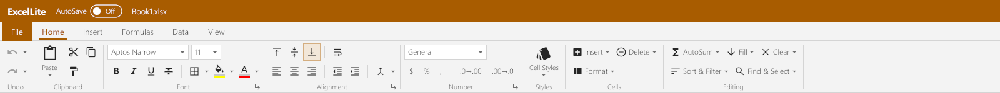
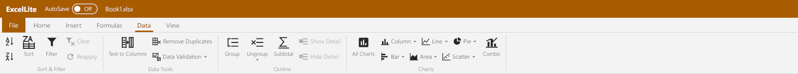
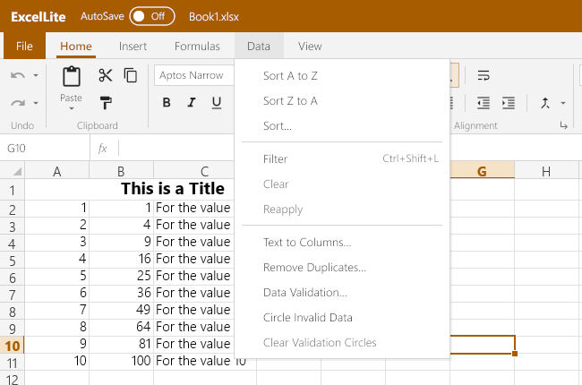
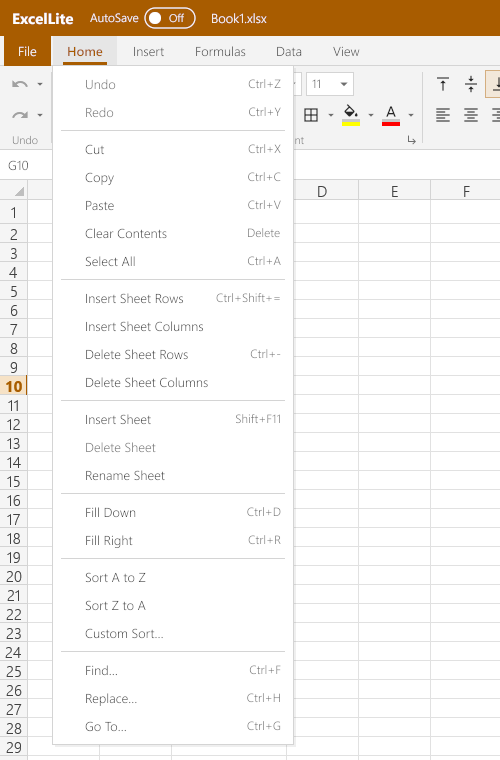
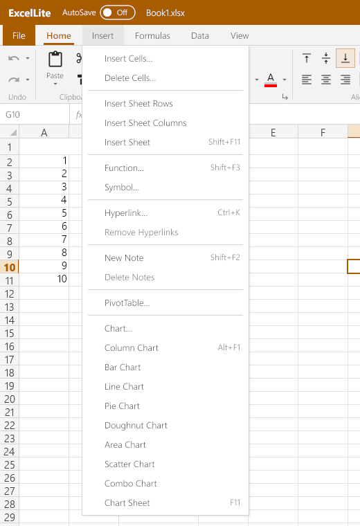
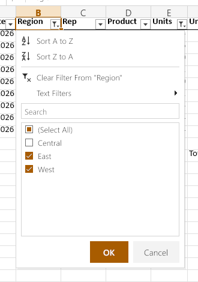
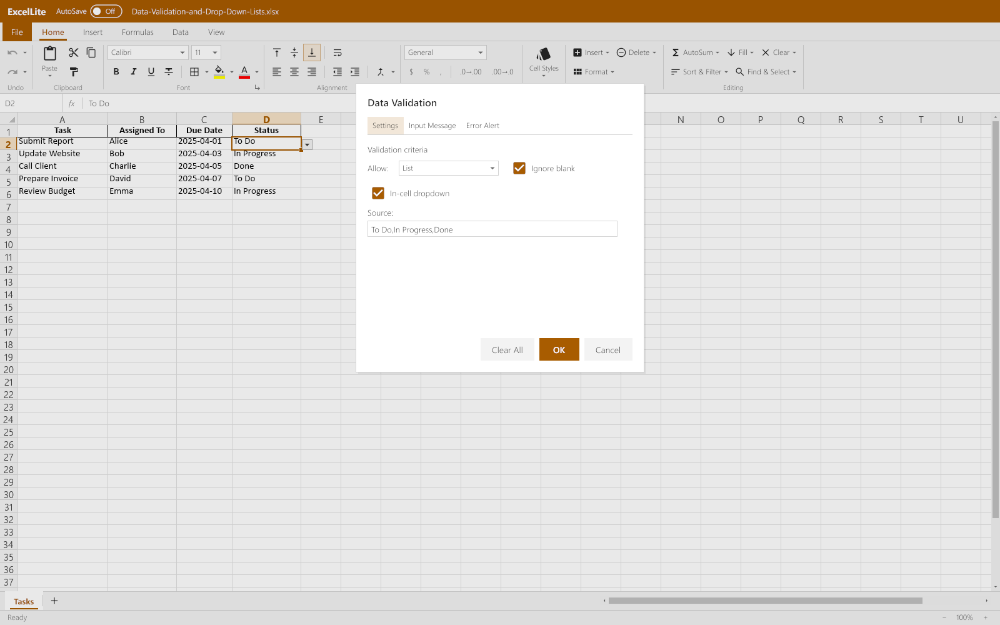
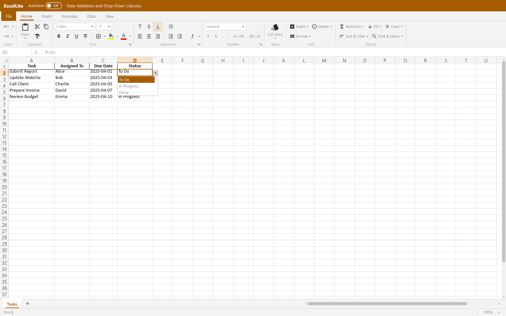

# ExcelLite

ExcelLite opens and edits `.xlsx`, `.xlsm`, `.xls`, `.csv` and `.tsv` files,
with formatting, multiple sheets, formulas, charts, PivotTables and PDF
export. See [Excel Functions](./EXCEL-FUNCTIONS.md) for formula behavior and
the implemented function catalog.

## Ribbons and menus

The screenshots below are captures of ExcelLite's current UI, using the
included sample workbooks.

### Home ribbon



The Home ribbon groups common editing commands: **Undo**; **Clipboard** for
paste, cut, copy and Format Painter; **Font** and **Alignment** for text and
cell appearance; **Number** for display formats; **Styles** for built-in
cell styles; **Cells** for inserting, deleting and formatting cells, rows,
columns and sheets; and **Editing** for AutoSum, Fill, Clear, Sort & Filter,
and Find & Select. The ribbon's controls act on the current selection.

### Data ribbon



**Sort & Filter** orders and filters worksheet data. **Data Tools** splits
text into columns, removes duplicate rows and configures validation rules.
**Outline** groups and summarizes rows or columns. **Charts** starts a
chart picker or inserts a common chart type. The **Data** menu dropdown
offers the corresponding sorting, filtering, Text to Columns, Remove
Duplicates, validation and validation-circle commands:



### Menu dropdowns



The **Home** menu provides undo/redo, clipboard operations, clearing and
selection, inserting or deleting sheet rows and columns, sheet management,
Fill Down/Right, sorting, Find, Replace and Go To. Availability depends on
the current selection and editing state.



The **Insert** menu inserts or deletes cells (with a choice of shift
direction), sheet rows, columns or sheets; opens Function and Symbol
pickers; creates or removes hyperlinks and notes; and creates PivotTables
and charts. Chart commands include the chart-type picker, common chart
types, combo charts and chart sheets.

## User interface and workbook features

### Menu bar, Home ribbon and File page

The menu bar under the title has **File**, **Home** (Undo, Redo, Cut, Copy,
Paste, Clear Contents, Select All, Insert/Delete Sheet Rows and Columns,
Insert/Delete/Rename Sheet, Fill Down/Right, Sort A to Z / Z to A, Custom
Sort…, Find…, Replace…, Go To…), **Insert** (Insert Cells… / Delete Cells…
with shift right/down/left/up or entire row/column, Insert Sheet
Rows/Columns, Insert Sheet, Function…, Symbol…, Hyperlink…, Remove
Hyperlinks, New/Edit Note, Delete Notes, PivotTable…, Chart…, Column /
Bar / Line / Pie / Doughnut / Area / Scatter / Combo Chart, Chart Sheet),
**Formulas** (Calculate Now), **Data** and **View** (zoom, gridlines). Home
and Data are tabs, as in Excel: clicking one shows its ribbon (the active
tab is underlined); while the active cell is in a PivotTable the contextual
**PivotTable Analyze** and **Design** tabs join them, and while a chart is
selected (or a chart sheet is active) **Chart Design** and **Format**.

Under the menu bar the **Home ribbon** has Excel's Home tab groups: Undo
(Undo ▾ and Redo ▾, see below), Clipboard (Paste ▾ with Paste Values / Formulas / Formatting, Cut, Copy,
Format Painter — double-click keeps it on until Esc), Font (font, size,
bold, italic, underline, strikethrough, borders, fill and font color),
Alignment (vertical and horizontal alignment, wrap text, indent, Merge &
Center ▾ with Merge Across / Merge Cells / Unmerge), Number (General,
Number, Currency, Accounting, dates, time, percentage, fraction,
scientific, text; $ % , and more/fewer decimals), Styles (built-in cell
styles: Good, Bad, Neutral, Title, Headings, Total, Note, Input, Output,
Calculation, Check Cell, Comma, Currency, Percent), Cells (Insert ▾,
Delete ▾, Format ▾: row height, column width, AutoFit, default width,
hide/unhide rows, columns and sheets, rename, Format Cells) and Editing
(AutoSum ▾, Fill ▾, Clear ▾, Sort & Filter ▾, Find & Select ▾). The
controls show the active cell's format; on a narrow window the ribbon
scrolls sideways (wheel or the ‹ › buttons).

**Undo and Redo** are split buttons in both apps, as in Office: the
button takes back (or repeats) one step; its ▾ opens the history list,
most recent first, up to 100 entries, each named as Office names it
("Typing 'Total' in B5", "Bold", "Fill Color", "Insert Rows", "Paste",
"Sort", "Column Width", ... in ExcelLite; "Typing 'hello'", "Font Size",
"Bullets", "Insert Table", "Replace All", "Move Text", ... in WordLite).
Pointing at an entry highlights it and every entry above it and the
footer reads "Undo 3 Actions" ("Cancel" when none is pointed at);
clicking takes them all back at once. The buttons' tooltips and the Home
menu's items name the next step ("Undo Typing 'x' (Ctrl+Z)"), and both
are greyed when there is nothing to undo or redo.

### Data tab, AutoFilter, Data Tools and Outline

The **Data ribbon** has the Sort & Filter group: Sort A to Z, Sort Z to A,
Sort (the Custom Sort dialog), Filter (Ctrl+Shift+L), Clear and Reapply;
the Data Tools group: Text to Columns, Remove Duplicates and Data
Validation ▾ (Data Validation…, Circle Invalid Data, Clear Validation
Circles); the Outline group: Group, Ungroup ▾ (Ungroup…, Clear
Outline), Subtotal, Show Detail and Hide Detail; and, as ExcelLite has no
Insert tab, Excel's Insert ▸ Charts group: All Charts (the Insert Chart
dialog), Column ▾, Line ▾, Pie ▾, Bar ▾, Area ▾, Scatter ▾ and Combo.

Filter turns the AutoFilter on for the selection, or for a single cell the
block of data around it (its first row is the header), one per sheet; the
header cells get drop-down buttons, which take a click before the cell
(Alt+Down opens the active header cell's). The drop-down has Sort A to Z /
Z to A (Smallest to Largest, Oldest to Newest for numbers and dates; the
whole filter range is sorted, then filtered again), Clear Filter From
"…", Text / Number / Date Filters (Equals, Does Not Equal, Begins With,
Ends With, Contains, Does Not Contain, Greater Than (Or Equal To), Less
Than (Or Equal To), Before, After, Between, Top 10…, Above / Below Average
and Custom Filter…: the Custom AutoFilter dialog with two conditions, And
or Or, and `*` `?` wildcards), a search box and the checklist of the
column's distinct displayed values ((Select All), sorted, (Blanks) last;
only values of rows the other columns' filters show), OK and Cancel.
Dates are listed flat, not grouped by year and month.



In the AutoFilter dropdown, sort commands reorder the filter range;
**Clear Filter From** removes that column's criteria; **Text Filters**
opens condition-based filters; search narrows the checklist; and the
checked values, **OK** and **Cancel** control which rows remain shown.

Filtering hides the rows that don't match; they are kept apart from rows
hidden by hand, so Clear shows only what the filter hid. A filtered
column's button shows a funnel, the filtered range's row numbers turn
blue, and the status bar says "N of M records found". Editing doesn't
filter again; Reapply does (taking in rows of data added right below the
range). As in Excel, Fill Down / Right, Delete, Clear, formatting and
Copy skip the rows the filter hides (a copy pastes as adjacent rows), and
a single copied row pasted over the filtered rows fills only those shown.
Turning the filter on or off and every filter change are one undo step
each.

Files: `.xlsx` keeps `<autoFilter>` with value lists (and Excel's date
groups), custom, Top 10 and dynamic (above/below average; other dynamic
types are kept but not evaluated) filters, the hidden
`_xlnm._FilterDatabase` name and the hidden rows; color and icon filters
are dropped with a warning. `.xls` keeps AUTOFILTERINFO, AUTOFILTER (two
conditions or Top 10), FILTERMODE, the `_FilterDatabase` NAME and the
drop-down button objects; value lists of more than two values (Excel
2007's AUTOFILTER12) can't be read or written there and are listed before
saving, their rows staying hidden. A file doesn't say which hidden rows a
filter hid: on opening, the hidden rows inside a filtered range count as
filtered.

**Text to Columns** splits a one-column selection (anything wider gets
Excel's "one column at a time" message) in one dialog in place of
Excel's three-step wizard: Delimited (Tab, Semicolon, Comma, Space, one
Other character; consecutive delimiters as one; text qualifier `"`, `'`
or none; the delimiter is guessed from the data) or Fixed width (click
the fixed-pitch preview's ruler to set or remove a break, or type the
positions), a preview of the first rows whose column headers pick each
column's format (General, parsed as typed; Text, in Text-formatted
cells; Date in MDY, DMY, YMD, MYD, DYM or YDM order; Do not import) and
the destination (the selection's top-left by default). Excel's "Do you
want to replace the contents of the destination cells?" comes first
when other cells would be overwritten. One undo step.

**Remove Duplicates** works on the selection, or for a single cell the
data around it: "My data has headers" (guessed as for Sort), a checklist
of the columns with Select All / Unselect All. Rows whose chosen columns
repeat an earlier row (text ignoring case, numbers by value) go, the
rows below moving up inside the range only; then "N duplicate values
found and removed; M unique values remain." One undo step.

**Data Validation** has Excel's Settings, Input Message and Error Alert
tabs: Allow Any value, Whole number, Decimal, List (a comma-separated
source or `=` a range or name; In-cell dropdown), Date, Time, Text length
or Custom (a formula), with between / not between / equal to / ... and
boxes taking numbers, dates, times, references or formulas (relative to
the active cell), Ignore blank, the input message's title and text, and
the alert's style, title and message (Excel's own when empty). Clear All
resets the dialog; OK sets the rule on the selection in one undo step.
Typed entries (in the cell or the formula bar) are checked when
committed: Stop offers Retry / Cancel, Warning "Continue?" Yes / No /
Cancel, Information OK / Cancel. Pasted and filled values aren't checked,
as in Excel. The selected cell shows its input message in a yellow box
under it, and a List cell gets a drop-down button at its right (Alt+Down
opens it; arrows and Enter pick). Circle Invalid Data draws red ellipses
around up to 255 cells breaking their rules; a circle goes when its cell
is fixed. Rules move with inserted or deleted rows, columns and cells,
with sorting and with dragged cells (their references too); copying and
pasting cells doesn't carry rules yet.



The dialog's **Settings** tab defines allowed entries; **Input Message**
can show guidance when a validated cell is selected; and **Error Alert**
controls the response to invalid typed entries. This example shows a List
rule sourced from `To Do,In Progress,Done`.



For a List rule with **In-cell dropdown** enabled, the cell's arrow shows
the permitted choices. Selecting a choice enters it into the cell.

Files: `.xlsx` reads and writes `<dataValidations>` (and reads the
`x14:dataValidations` Excel 2010+ keeps in the sheet's extLst for lists
on other sheets); `.xls` reads and writes DVAL and DV records. Samples/
Data-Tools.xlsx and .xls have a rule of each kind, Text to Columns data
and a duplicates table.

**Group** (Shift+Alt+Right) puts the selected whole rows or columns one
outline level deeper, up to 7 levels; for a cell range Excel's Group
dialog asks Rows or Columns. **Ungroup** (Shift+Alt+Left) takes them a
level up, showing rows a collapsed group hid; Ungroup ▾ > Clear Outline
removes the sheet's whole outline (hidden rows stay hidden, as in
Excel). Grouped rows get a gutter left of the row headers, grouped
columns one above the column headers, wider (taller) with each level:
level buttons 1, 2, 3… in the header band, and for each group a bracket
along its detail with a − button at its summary row (below the detail,
or above when the sheet says summaries are above; columns: right or
left). − collapses the group (hides its detail and marks the summary
collapsed), + expands it (groups collapsed inside it stay collapsed),
level button N shows rows of levels below N; the active cell moves off
rows that get hidden. Hidden rows and columns keep their height and
width for when they are shown again. **Hide Detail** collapses, for each
selected row (column), the innermost group it is the summary of or is
in; **Show Detail** expands collapsed ones (whole rows act on rows only,
whole columns on columns only). Inserted rows inside a group join it.

**Subtotal** works on the selection or the list around the active cell
(its first row the headers): At each change in (a column), Use function
(Sum, Count, Average, Max, Min, Product, Count Numbers, StdDev, StdDevp,
Var, Varp), Add subtotal to (a checklist of the columns; the last one is
checked), Replace current subtotals and Summary below data, plus Remove
All. It inserts a row after (or above) each run of equal values with
`=SUBTOTAL(n,range)` in the chosen columns and a bold "<value> Total"
("Count", "Average"…) label, and a "Grand Total" row at the end (or at
the top) whose SUBTOTAL covers the whole column, so nested subtotals
aren't counted twice; the rows get the outline (level 1 the grand total,
2 the subtotals, 3 the detail). Without Replace, new subtotals nest
inside the existing groups (no second Grand row). Remove All deletes the
rows holding SUBTOTAL formulas and the list's row outline. Each is one
undo step. The model has no page breaks, so "Page break between groups"
isn't offered.

Files: `.xlsx` reads and writes row `outlineLevel`/`collapsed`/`hidden`,
col `outlineLevel`/`collapsed`, `sheetFormatPr` `outlineLevelRow`/
`outlineLevelCol` and `sheetPr/outlinePr` `summaryBelow`/`summaryRight`;
`.xls` the ROW record's outline level and collapsed bits, COLINFO level
and collapsed, GUTS (gutter size and levels) and WSBOOL's summary bits.
Samples/Data-Outline.xlsx and .xls have a subtotalled list (North
collapsed), a budget with rows and columns grouped two levels deep (one
of each collapsed) and a sheet with summaries above and left.

### Keyboard shortcuts

Arrows / Shift+arrows / Ctrl+arrows, PageUp/PageDown, Home, Ctrl+Home,
Ctrl+End, Tab/Enter, Ctrl+A, Ctrl+C (copies the selection as tab-separated
text), Ctrl+PageUp/PageDown (sheets), Ctrl+N (new window), Ctrl+O (Open page),
Ctrl+F12 (Open dialog), Ctrl+S (save), F12 (Save As), Ctrl+P (Print),
Ctrl+W (close), Esc (leave the File page / menu), Ctrl+wheel or
Ctrl+Alt +/− and Ctrl+0 (zoom; also the status bar's − 100% +), Shift+wheel
(scroll sideways), F9 (recalculate all formulas), Ctrl+F (Find), Ctrl+H
(Replace), Ctrl+G or F5 (Go To), Ctrl+K (hyperlink), Ctrl+D / Ctrl+R (fill
down / right), Shift+F2 (new or edit note), Shift+F3 (Insert Function).

### PivotTables

**Insert > PivotTable…** opens Create PivotTable: the table/range
(prefilled with the selection, or the data around the active cell) and New
Worksheet (A3 of a sheet inserted before the active one) or Existing
Worksheet with a location. The report starts as Excel's empty placeholder
and the **PivotTable Fields** pane opens at the right of the grid; it shows
whenever the active cell is in a report (its X closes it; Field List on the
PivotTable Analyze tab or in the right-click menu brings it back). The pane
has a search box, the checklist of the source's fields (checking one puts
it in Rows, or in Values with Sum when the column holds only numbers;
unchecking takes it out) and the Filters, Columns, Rows and Σ Values
areas. Field chips are dragged between and within the areas with the mouse
(dropped outside them, a field is removed); a click on a chip opens its
menu: Move Up / Down / to Beginning / to End, Move to Report Filter / Row
Labels / Column Labels / Values, Remove Field and Field Settings… or Value
Field Settings…. With two or more value fields Σ Values appears in Columns
(it can be moved to Rows).

The report is laid out as Excel lays it out: compact form (Row Labels /
Column Labels headers, inner items indented, subtotals on the outer item's
row), outline form (a column per row field, field names as headers) or
tabular form (outer items beside their first inner item, "X Total" rows),
"(blank)" items, Grand Total row and column, report filters above the body
("(All)", the item, or "(Multiple Items)"), number labels keeping their
source format, and the default PivotStyleLight16 look (light blue header
and total bands with a blue line, bold headers, outer items, subtotals and
totals) as cell formats. Items are told apart as Excel does (text ignoring
case, numbers and dates by value) and sorted ascending (blanks last). The
columns are widened to fit after each change (never narrowed).

- **Value Field Settings**: custom name, Summarize Values By (Sum, Count,
  Average, Max, Min, Product, Count Numbers, StdDev, StdDevp, Var, Varp),
  Show Values As (No Calculation, % of Grand Total, % of Column Total, % of
  Row Total) and a number format. **Field Settings**: custom name and
  Subtotals Automatic or None. Typing over a value field's name renames it.
- Row Labels / Column Labels (or field name) cells and the report filters'
  values have drop-down buttons: Select field (the compact headers stand
  for every field of their axis), Sort A to Z / Z to A, Clear Filter From,
  a search box and the checklist of the items ((Select All)); a filtered
  field's button shows a funnel. Hidden items leave the totals, as in Excel.
- **PivotTable Analyze**: Field Settings, Refresh ▾ (Refresh, Refresh All),
  Change Data Source, Clear All, Select (the whole report), Show Details,
  Move PivotTable (new or existing worksheet) and Field List. **Design**:
  Subtotals (don't show / at the bottom / at the top of the group), Grand
  Totals (off / on / rows only / columns only), Report Layout (compact,
  outline, tabular; repeat or don't repeat item labels) and Blank Rows.
- Right-click on a report cell: Copy, Format Cells…, Number Format…,
  Refresh, Sort ▸, Remove "field", Summarize Values By ▸, Show Values As ▸,
  Show Details, Value Field Settings… / Field Settings…, Show/Hide Field
  List. Sort A to Z / Z to A on a label cell sorts its field.
- Double-clicking a value (or Show Details) puts the source rows behind it
  on a new sheet. GETPIVOTDATA(data_field, pivot_table, field1, item1, …)
  reads a report's values (recalculated with every calculation).
- A report changes only when it is refreshed, as in Excel; Refresh takes
  in edited values and columns renamed or added within the source range
  (a renamed column drops out of the areas). Every change is one undo step.
  Covering other data asks "There's already data in [Book]Sheet. Do you
  want to replace it?"; reports can't overlap. The report's cells can't be
  typed over, cleared, pasted on, cut, filled or sorted ("You can't change
  this part of a PivotTable report."); they can be selected, copied and
  formatted, and Delete on a selection holding whole reports deletes them.
  Inserting or deleting rows or columns above or left of a report moves it
  (and moves the source of reports reading those rows); rows through a
  report are refused. The source may be a reference or a defined name.

Files: `.xlsx` reads the pivotTableDefinition (location, fields with
their items, hidden items, sort, subtotals, captions, row/column/page
fields, data fields with function, Show Values As and number format, grand
totals, compact/outline/tabular form, repeated labels, blank rows) and its
pivotCacheDefinition (worksheet source or name, shared items); the cells
are kept as saved, formatted with the report style and given their
buttons. It writes the cache definition with every field's shared items,
the cache records, the table definition with its row and column items as
laid out, and the relationships, content types and `<pivotCaches>`; the
cache has `refreshOnLoad` so Excel rebuilds it when it opens the file.
Reports whose source is outside the workbook (OLAP, external data) are
kept as plain cells with a warning. `.xls`: PivotTables are read and saved
as plain cells (a warning on opening and before saving). Date grouping
(Years/Quarters/Months), calculated fields, styles other than the default
look, "Defer Layout Update" and the +/- buttons aren't supported.
Samples/PivotTables.xlsx has a sales table and three reports (compact with
a column field, tabular with a report filter and subtotals, outline with
two value fields, one as % of the grand total).

### Charts

Charts in `.xlsx` files are drawn over the cells where they are anchored,
moving with scrolling, zoom and frozen panes, and chart sheets are sheets
of their own (their tab among the others) with the chart filling the
window. Kinds drawn: column and bar (clustered, stacked, 100% stacked, with
the gap width and overlap), line (markers, smoothed, stacked), pie (from
12 o'clock clockwise, exploded slices), doughnut (hole size, one ring per
series), area (standard and stacked), scatter (markers, lines, smoothed
lines) and combinations of them with a secondary value axis. They look as
Excel 2013+ draws them by default: the theme's accent colours (Excel's
lighter and darker variations after the sixth series), grey text in the
theme's font, light grey gridlines; the file's own colours, line widths and
dashes, markers, fonts and sizes win where it has them. Titles (their own
text, a cell, or Excel's automatic title from a single series' name),
legends (right, left, top, bottom, top right, overlaid, deleted entries),
axes (category/date labels; value-axis bounds, major units, number formats,
major and minor gridlines, reversed direction, crossing, logarithmic scale,
titles, visibility and tick marks), category labels that wrap,
turn 45° or thin out when crowded, data labels (value, percentage,
category, series name, position, number format), negative values, blank
cells as gaps, zeros or spanned, and hidden rows left out ("Show data in
hidden rows" off) are drawn.

Charts draw from the cells as they are now (a series' references are read
at each repaint), so they follow edits and recalculation; the values the
file cached are used when a reference can't be read. Inserting or deleting
rows, columns or cells moves and sizes the charts as Excel does ("move and
size with cells"; one-cell and absolute anchors move or stay) and rewrites
their references, renaming a sheet renames them and deleting one leaves
`#REF!` (the cached values are then shown), all undoable. On a chart sheet
the commands that change cells are off.

Making charts: Insert > Chart… (or All Charts on the Data ribbon) opens
Insert Chart with the kinds ExcelLite makes: clustered, stacked and 100%
stacked column and bar, line (with or without markers, stacked), pie,
doughnut, area (standard, stacked, 100%), scatter (markers, or lines and
markers) and Clustered Column - Line on Secondary Axis; the Insert menu's
entries and the Data ribbon's Charts group insert them directly, Alt+F1
the default chart (clustered columns) and F11 the default chart on a chart
sheet of its own (Chart1, Chart2 ...) before the active sheet. The data is
the selection, or the block of data around the active cell, laid out as
Excel lays it out: a blank top-left cell makes the first row and column
labels, a first row without numbers over numbers holds the series names, a
first column of text or dates the categories; series run down the columns
when there are at least as many rows as columns, else along the rows; for
a scatter chart an unlabelled first column is the X values. The chart
(5 × 3 in, 480 × 288 px) goes right of the data with a column between (in
the middle of the window when that is out of sight), titled "Chart Title"
(or the series' name when there is one series), with a legend at the
bottom for several series or slices; it is selected and the Chart Design
tab shown, and Ctrl+Z takes it away in one step.

Working with a chart: a click selects it and the part of it under the
pointer (chart area, plot area, title, legend, a series, its data labels,
an axis, its title or gridlines: a blue frame, or a series' points); Esc
goes back to the whole chart, then to the cells. Dragging it moves it,
dragging one of its eight handles sizes it (Shift keeps a corner's
proportions, Alt snaps to the cell grid, for moving too), with a dashed
outline while dragging and the move or sizing cursors; the arrow keys
nudge it a pixel (Ctrl+arrow a quarter). The anchor keeps its kind (two
cells, one cell and a size, or a position). Delete deletes the selected
part (title, legend, a series, labels, an axis, its title, gridlines) or,
with the chart area selected, the chart. Ctrl+C / Ctrl+X / Ctrl+V copy,
cut and paste a chart within the workbook (the copy goes 20 px from the
selected chart, or at the active cell; its references stay as they were).
A double-click on the title, F2 or Enter with it selected, or typing over
it edits the title in place (Enter sets it, Esc leaves it). Each change is
one undo step, and the chart stays selected through undo and redo. The
right-click menu has Cut, Copy, Paste, Edit Text (the title), Change Chart
Type…, Select Data…, Move Chart…, Format Chart Area… and Delete.

The **Chart Design** tab: Add Chart Element ▾ (primary horizontal and
vertical axes and axis titles, chart title none or above, data labels none,
center, inside end, outside end or best fit (the nearest a kind allows),
major and minor gridlines both ways, legend none, right, top, left or
bottom; the ones in effect are ticked), Change Colors ▾ (Colorful Palettes
1-4 from the theme's accents, Monochromatic Palettes 1, 2, 4, 6; the first
puts back the automatic colours; a pie's slices are coloured one by one),
Chart Styles ▾ (Style 1, Excel's default; 2 data labels without value axis
and gridlines; 3 a shaded background; 4 dark; 5 outlined, lightly filled
shapes; 6 a bold title and dashed gridlines), Switch Row/Column, Select
Data (Select Data Source: the chart data range, which the chart follows
as it is typed; the series with Add, Edit (Edit Series: the name, a cell
or text, and the values), Remove, Move Up and Move Down; the category
labels; show empty cells as gaps, zero or connected; show data in hidden
rows and columns), Change Chart Type (the kinds with icons; for the combo
each series' kind (clustered or stacked column, line, line with markers,
area, stacked area) and a Secondary Axis box) and Move Chart (a new chart
sheet, named, or as an object on a worksheet; moving a chart sheet's chart
onto a sheet deletes the chart sheet, in one undo step). The **Format** tab:
Chart Elements (pick the part to format), Format Selection (Format …: fill
and border colours), Reset to Match Style, Shape Fill and Shape Outline
(the colour menus) for the chart area, plot area, title, legend, a series
(a line's colour and markers), labels, axes and gridlines. A chart with a
group of a kind ExcelLite doesn't draw (radar, stock ...) can be moved,
sized, copied and deleted but not changed. Quick Layout and the Format pane
aren't there.

Files: `.xlsx` reads the drawings' anchors (two-cell, one-cell, absolute),
the chart parts (`c:chartSpace`) and chart sheets with the workbook's
theme, and writes drawings, chart parts, chart sheets, relationships and
content types in ECMA-376's element order with cached values. A chart read
from a file is saved as it came (with its style, colour and shape parts),
only its references and cached values brought up to date, so what
ExcelLite doesn't model is kept, as long as it is only moved or sized (its
anchor is written anew); a chart changed in any other way, and a chart made
here, is written from the model with every colour explicit (a PivotChart
changed so loses its link to the report). The workbook's theme is saved back. PivotCharts
are drawn from their report's cells and kept as PivotCharts. `.xls`: charts
and chart sheets can't be read or saved (a warning on opening and before
saving); `.numbers` charts are dropped with a warning. PDF export prints
the charts as vector graphics where they are on the sheet, and chart
sheets on a landscape page. Samples/Charts.xlsx (written by
`go run ./excel/cmd/chartsample`) has a chart of each kind and a chart
sheet; Samples/Charts-Created.xlsx (`go run ./excel/cmd/chartsample
-created`) the charts the editing commands make and change (each kind,
titles, legends, labels, axis titles, gridlines, palettes, styles, a
switched row/column, combos, a chart moved to a chart sheet);
Samples/Pivot-Tables-and-Charts.xlsx has a PivotChart made by Excel.

### Editing

- Typing replaces the active cell's content (Enter mode: the arrow keys
  commit and move); F2, a double-click or a click in the formula bar edit
  the existing content (Edit mode; F2 switches between the modes). The entry
  shows in the cell, growing to the right, and in the formula bar.
- Enter / Shift+Enter commit and move down / up, Tab / Shift+Tab right /
  left, Ctrl+Enter stays; Alt+Enter adds a line break; Esc cancels.
- Entries are typed as Excel types them: numbers (`1,234.5`, `(12)`, `1E3`),
  percentages and currency (which give a General cell a `0%` or `$` format),
  dates and times (`1/15/2026`, `15-Jan`, `3:45 PM`, ...), TRUE/FALSE, error
  values, a leading `'` for text. A leading `=` (or `+`/`-` before a
  reference or function) makes a formula; function names and references are
  upper-cased and missing closing parentheses added. A formula that doesn't
  parse is reported in the status bar and stays in the editor. Typed
  formulas are dynamic arrays (results spill) as in Excel 365.
- Delete clears contents (formats stay); Backspace starts an empty entry.
- Ctrl+X / Ctrl+C / Ctrl+V: cells copied in the window paste with their
  formulas (relative references shifted), values and styles, tiled over a
  selection that is a multiple of the copied size; a cut moves the cells and
  formulas and defined names pointing at them follow. Any other change ends
  cut or copy mode, as in Excel. Text from other programs (tab-separated
  lines) is pasted as typed entries.
- Ctrl+Z / Ctrl+Y undo and redo every change (100 levels).
- Formatting applies to the whole selection as one undoable step; empty
  cells keep their format. Ctrl+B / Ctrl+I / Ctrl+U / Ctrl+5 toggle bold,
  italic, underline, strikethrough; Ctrl+Shift+~ $ % # @ ! set General,
  currency, percent, date, time and number formats; Ctrl+1 opens Format
  Cells (Number, Alignment, Font, Border, Fill). Rows without their own
  height grow to fit a larger font or wrapped text.
- Drag a column or row header divider (the cursor changes over it) to resize;
  the status bar shows the size as Excel's tooltip does. Dragging inside a
  selection of whole columns or rows resizes all of them; dragging to zero
  hides. Hidden rows and columns (Format > Hide too) keep their size for
  Unhide, which finds them anywhere in the selection (Select All: the whole
  sheet). Double-clicking a divider fits the column to its widest text (the
  row to its tallest), as Excel's AutoFit does. Undoable.
- Ctrl+Shift+= / Ctrl+- insert / delete the selected rows (columns when whole
  columns are selected). References everywhere in the workbook, defined
  names, merged cells, sizes, frozen panes and spills follow; references to
  deleted cells become `#REF!`.
- Insert Cells / Delete Cells shift the cells right, down, left or up;
  references into the moved cells follow them (a reference partly outside
  the moved strip is left alone), and references to deleted cells become
  `#REF!`.
- Fill: Ctrl+D / Ctrl+R copy the top row / left column (formulas shifted).
  Dragging the fill handle continues a series: number trends (1, 3 → 5, 7),
  dates by day, day and month names, text ending in a number (Item1 →
  Item2, Q01 → Q02); anything else is copied with formulas shifted.
  Dragging back into the selection clears cells.
- Sort A to Z / Z to A sorts the selection (or, for a single cell, the data
  around it) by the active cell's column, guessing a header row. Custom
  Sort takes up to three keys, a header option and case sensitivity. Whole
  rows of the range move with their formats, notes and links, and relative
  references in moved formulas shift. Blanks sort last.
- Find & Replace: within the sheet (or the selection) or the whole
  workbook, looking in formulas or values, with match case, match entire
  cell and `*` `?` `~` wildcards; Find Next, Find All, Replace, and Replace
  All as one undo step. Go To accepts B12, Sheet2!A1:C5, C:D, 3:7 or a
  defined name.
- Notes: New Note (Shift+F2) adds a note, marked by a red triangle in the
  cell's corner and shown on hover or when the cell is selected. Hyperlinks
  (Ctrl+K): text to display, address (URL, mailto:, file, or #Sheet2!A1)
  and ScreenTip; the cell takes the blue underlined Hyperlink style, and
  Ctrl+click follows the link. Notes and links are kept in `.xlsx` and
  `.xls`.
- Insert Function lists the implemented functions by category with a
  search box and inserts `=NAME(`; Insert Symbol types a symbol into the
  cell entry.
- Shift+F11 inserts a sheet; double-click a tab to rename it. Sheet renames
  and deletions are applied to formulas.
- Formulas are recalculated after every change, incrementally: only those
  that depend on the changed cells (an edit takes a few milliseconds in a
  workbook of 100,000 formulas; inserting a row there takes ~0.3 s).
- SUBTOTAL skips rows hidden by AutoFilter; function numbers 101–111 also
  skip manually hidden rows. AGGREGATE's options control whether hidden rows,
  nested SUBTOTAL/AGGREGATE formulas and errors are skipped.
- The title shows `•` while there are unsaved changes; closing the window
  then asks to save.

### Mouse

- Right-click menus. ExcelLite: cells (cut/copy/paste and paste values,
  formulas or formatting, insert/delete, clear, sort, notes, Format Cells,
  links), row and column headers (plus height/width, hide/unhide) and sheet
  tabs (insert, delete, rename, hide/unhide).
- Hover text: every ribbon button and box shows its name, shortcut and a
  description; menu items show a description.
- ExcelLite: Ctrl+click or Ctrl+drag adds separate ranges to the selection
  (formatting and clearing act on all of them as one undo step; cut, copy
  and paste refuse, as in Excel). Drag the selection's border to move the
  cells, Ctrl+drag to copy them; formulas pointing at moved cells follow,
  and dropping on data asks first. While typing a formula, clicking or
  dragging over cells (or headers) inserts their reference, and the
  formula's references are outlined in colour on the sheet.
- Scrollbars behave as Windows': arrow buttons step and repeat while held,
  holding the track pages toward the pointer, Shift+click jumps there,
  dragging the thumb shows the row/column (Excel) or page (Word) and snaps
  back if the pointer strays far from the bar.

`calccheck` recalculates workbooks and diffs the results against the values
Excel saved — any real workbook becomes a test:

```sh
go run ./excel/cmd/calccheck Samples/Book1.xlsx
```

`excelshot` renders a sheet to a PNG without a window, for checking rendering:

```sh
GOOS=windows go build -o bin/excelshot.exe ./excel/cmd/excelshot
bin/excelshot.exe -o out.png -w 1280 -h 800 Samples/Book1.xlsx
bin/excelshot.exe -window -ribbon data -filter B1 -o out.png Samples/Data-AutoFilter.xlsx
bin/excelshot.exe -window -select A3 -data list -o out.png Samples/Data-Tools.xlsx
bin/excelshot.exe -window -ribbon data -data rows2 -o out.png Samples/Data-Outline.xlsx
bin/excelshot.exe -window -sheet 1 -select A5 -pivot menu -o out.png Samples/PivotTables.xlsx
bin/excelshot.exe -chart 4 -zoom 1.5 -o out.png Samples/Charts.xlsx
```

`-window` draws the whole window; `-ribbon data`, `-menu N`, `-filter B1`
(that header's AutoFilter drop-down, with `-filtersub` its Filters submenu
or `-dialog custom|top10`), `-data` (`ttc`, `ttc-fixed`, `dups`,
`validation`, `validation-input`, `validation-error`, `list`, `circles`, or
`alert` with `-edit`; the Outline group's `group`, `subtotal`, `hide`,
`show`, `rowsN`/`colsN` for level button N; `-sheet N` picks the sheet),
`-ribbon analyze|design` and `-pivot` (`create`, `value`, `field`, `menu`
or `chip`, for the report at the selection), `-chart N` (only the sheet's
chart N, from 0, at its size times `-zoom`), `-chartsel N` (the window
with chart N, from 1, selected) with `-ribbon chartdesign|chartformat` and
`-chartui` (`insert`, `type`, `combo`, `data`, `series`, `move`, `format`:
the dialogs; `ctx`, `drag`, `resize`, `title`, `series1`; `alt`, `f11` on
the selection),
`-ctx`, `-drag` and `-page` show the rest.

## Importing Apple Numbers files

`.numbers` and `.pages` files (iWork 2013 and later: a zip of Snappy-
compressed protobuf archives, `Index/*.iwa`) open in ExcelLite and WordLite
by content, from the Open dialog, the command line or a double-click. They
are imported, not edited in place: Save goes to Save As (`.xlsx`/`.xls`,
`.docx`/`.doc`). iWork '09 files (gzipped XML) and password-protected
documents are reported as not supported. The status bar lists what was
dropped.

- **Numbers**: each table becomes a sheet (named after the table, or
  "Sheet - Table" when a sheet has several), at A1: numbers, currency,
  percentages, dates (as Excel serials), durations, booleans, text and
  rich text (as plain text), errors; number, currency, percent, scientific,
  fraction, date and duration formats; merged cells, column widths, row
  heights, hidden rows/columns, frozen header rows/columns; fonts, bold,
  italic, underline, strikethrough, sizes, text colors, fills (with banded
  rows), alignment and wrapping from the table, row, column and cell
  styles. Formulas are translated to Excel syntax (cell and range
  references, references to other tables as other sheets, whole-column
  references as the column's body cells, operators and functions Excel
  has) and kept only when ExcelLite computes the value Numbers saved;
  the others (Numbers-only functions such as DURATION or MONTHNAME) come
  in as values. Charts, pictures, shapes and text boxes, cell borders and
  conditional highlighting are dropped.

## Limitations compared with Excel

- Not shown and lost on save: images, shapes and text boxes (a warning),
  tables (ListObjects), conditional formatting and row/column default
  styles. Threaded comments aren't imported; classic cell notes are supported
  as plain text. Rich text runs within a cell are flattened, and rotated text
  is kept but drawn flat. Data validation rules are supported; see Data
  Validation above.
- Calculation: 3-D references (`Sheet1:Sheet3!A1`) and union references,
  the trim-reference operators (`A1:.A10`, `A1.:A10`, `A1.:.A10`; TRIMRANGE
  does the same), and PCRE-only regex features (Go's
  RE2 is used); STOCKHISTORY/TRANSLATE/DETECTLANGUAGE return `#CONNECT!`.
- Editing: references can't be picked with the mouse while typing a
  formula; pasting doesn't copy merges; notes and links don't move with
  copy/paste or fill; notes are plain text (rich text flattened, box size
  and position not kept); Ctrl+Shift+= / Ctrl+- insert/delete whole rows
  (the Insert Cells dialog is on the Insert menu and ribbon). Sort is top
  to bottom only (no sort by color or custom lists, no merged cells); Find
  searches by rows and not by format; the fill handle has no Auto Fill
  Options button.
- Formatting: a whole-column or whole-row selection formats only the used
  range (no row/column default styles); cell styles are applied as direct
  formats, not saved as named styles; no conditional formatting, Format as
  Table or Advanced Filter. Home > Fill has Fill Down and Fill Right; use
  the fill handle to extend a series or fill up, down, left or right. Theme,
  standard and custom colors are available. Rows grow but don't shrink
  automatically, and merged cells don't auto-fit.
- Charts: chart creation, moving, resizing, copying and formatting are
  available for the supported types described above. Radar, bubble, stock,
  surface and 3-D chart groups aren't drawn; they show a placeholder and
  can be moved, sized, copied or deleted, but not changed. Newer Excel
  chart types such as waterfall, histogram and treemap are dropped with a
  warning. Date categories are spaced evenly, not by date; multi-level
  category labels show only the inner level. The chart editor does not model
  trendlines, error bars, drop and high-low lines, up/down bars, data tables,
  gradient and picture fills, shadows and other effects, manual plot-area
  layout, rich text with several formats in a title, or PivotChart field
  buttons. An unedited `.xlsx` chart retains its original XML, including
  features the editor does not model; editing it rewrites the chart from the
  supported model, so those features may be lost. References follow inserted
  and deleted rows, columns and cells and sheet renames, but not cut/paste or
  dragged cells. `.xls` charts and chart sheets aren't supported.
- PDF export: no print titles, page headers/footers, custom print areas or
  images.
- `.xls` save: BIFF8 limits (65,536 × 256, 4,000 styles); dynamic arrays
  that spill become ordinary formulas (Excel shows `=@...`); LET/LAMBDA
  formulas, functions named as values (`GROUPBY(...,SUM)`) and references
  to other workbooks are saved as values only.
  `fileio.Fits` lists what won't fit before saving.

See [Excel Functions](./EXCEL-FUNCTIONS.md) for calculation coverage and unsupported functions.
