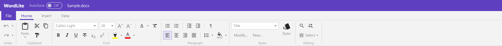
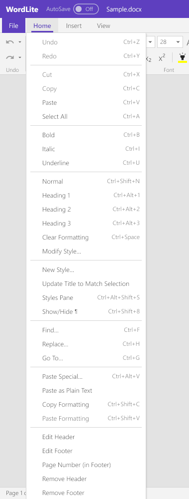
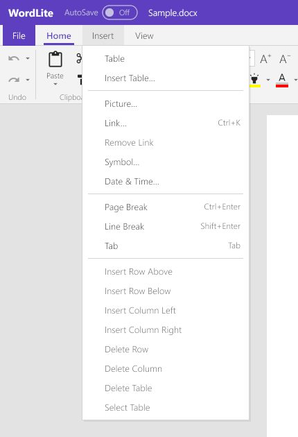
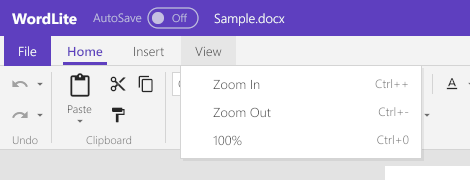

# WordLite

See [the documentation overview](./README.md) for the architecture and
build guides.

WordLite opens and saves `.docx`, `.doc` (Word 97-2003) and `.txt` documents.
It can also open `.docm` files, but macros are never run; use Save As to
keep changes, and macros are removed from the saved copy. Apple Pages
(`.pages`) files are imported read-only; use Save As to keep changes.
Documents open in a paginated page view with Word's styles: style gallery,
Modify Style, New Style, Update Style to Match Selection, deletion of custom
styles and a Styles pane;
fonts, sizes, bold/italic/underline/strike, sub/superscript, highlight,
change case, color, alignment, spacing, shading, indents, tabs, bullets and
numbering; undo; clipboard (Paste Special / Keep Text Only); Format Painter;
Find & Replace and Go To; and Show/Hide ¶ (Ctrl+Shift+8: paragraph, cell and
row marks, spaces, tabs, line and page breaks, and hidden text with a dotted
underline; never exported or printed; a section break shows as "Section
Break (Next Page)" etc.).

Sections have their own page size and orientation (portrait and landscape
pages mix in the page view), margins, text columns, break kind (next page,
continuous, even/odd page, next column), page numbering (restart, format)
and headers and footers (default, first page, odd/even; a section without
one shows the previous section's, as Word's Link to Previous), all read and
saved in `.docx` and `.doc`. Headers and footers are shown and edited
(double-click the top or bottom margin), with PAGE, NUMPAGES and
SECTIONPAGES fields for page, document-page and section-page numbers.
Deleting a section break's paragraph mark
merges the sections (the following section's settings win). Footnotes (at
the bottom of their page, under the separator line) and endnotes (after the
text) are shown, numbered in the document's formats, and saved in both
formats.

Nested tables, text boxes, shapes (rectangles, rounded rectangles,
ellipses, lines, arrows) and floating pictures are drawn where Word puts
them (positioned from the page, margin, column or paragraph; text stays
clear of objects that wrap top-and-bottom or square). A table of contents
stays a field (shaded while the caret is in it); F9 rebuilds it from the
headings with their page numbers. The Insert menu supports tables (grid
picker or Insert Table…, insert/delete rows and columns, Tab between cells),
pictures (shown, selectable, resizable by their handles, saved in `.docx`),
hyperlinks (Ctrl+K; Ctrl+click opens), symbols, date & time, and page/line
breaks. File > Export > PDF writes the pages as laid out; File > Print goes
through a PDF. Comments are kept on a `.docx` re-save but not shown or
edited. Tracked changes are not shown as markup: insertions appear as normal
text and deletions are hidden. Other fields show their last result; EMF/WMF
pictures, charts and SmartArt show as placeholders.

## Menus and ribbon

The screenshots show WordLite's menus and Home ribbon over the built-in
sample document.

### Home ribbon

The Home ribbon has six groups:

- **Undo**: Undo and Redo, with dropdown histories of recent editing actions.
- **Clipboard**: Paste (including Keep Text Only and Paste Special), Cut,
  Copy and Format Painter.
- **Font**: font family and size, grow/shrink, change case, clear formatting,
  bold, italic, underline, strikethrough, subscript, superscript, text
  highlight and font color.
- **Paragraph**: bullets and numbering, decrease/increase indent, Show/Hide
  formatting marks, left/center/right/justified alignment, line and paragraph
  spacing, and shading.
- **Styles**: apply a paragraph style, modify or create a style, and open the
  Styles pane.
- **Editing**: Find, Replace and Select (including Select All and Go To).

The controls reflect the current insertion point or selection. The ribbon's
**Shading** color control applies character shading to selected text,
paragraph shading to selected paragraphs (or the current paragraph at a
caret), and cell shading when whole table cells are selected. Its dropdown
offers No Color and a color palette; the button repeats the last color.
Shading is saved in `.docx` and `.doc`.

### Home menu

The **Home** menu exposes editing commands as menu items: Undo/Redo,
Cut/Copy/Paste, Select All, character emphasis, Normal and Heading styles,
Clear Formatting, Modify/New/Update Style, Styles pane, Show/Hide marks,
Find/Replace/Go To, Paste Special and plain-text paste, copy/paste
formatting, and header/footer editing and page-number commands. Some items
are disabled when they do not apply to the current selection.

### Insert menu

The **Insert** menu inserts a table (using a grid picker or Insert Table
dialog), picture, link, symbol, date/time, page break, line break or tab.
When the caret is in a table, the lower commands insert or delete rows and
columns, delete the table, or select it; they are disabled outside a table.

### View menu

The **View** menu changes page zoom: Zoom In and Zoom Out adjust it in
steps, and **100%** restores actual size.

### File page

**File** opens a full-window page rather than a dropdown. **Home** shows
blank-document and blank-workbook tiles and recent files; **New** creates a
document or workbook; **Open** browses for a file or opens a recent one.
**Info** shows document details, the AutoRecover interval, and the default
for AutoSave. AutoRecover periodically keeps a recovery copy of unsaved
changes. The title-bar AutoSave switch saves `.docx` files a few seconds
after edits; it is off by default and has no version history. **Save**
writes in the current format when possible, while **Save As** chooses
`.docx`, `.doc` or `.txt`. **Print** opens a PDF for printing, and **Export**
writes text, legacy Word format or PDF. **Close** closes the window.

## Keyboard shortcuts and mouse

**Keyboard shortcuts:** Ctrl+F find, Ctrl+H replace, Ctrl+G go to page, F3 /
Shift+F3 next / previous match (Enter / Shift+Enter in the find box),
Ctrl+K link, Ctrl+Shift+C / Ctrl+Shift+V copy / paste formatting,
Ctrl+Alt+V Paste Special, Ctrl+Shift+> / < grow / shrink font,
Ctrl+Alt+Shift+S Styles pane, Ctrl+Shift+8 Show/Hide ¶, Tab / Shift+Tab between table cells, Esc
leaves header/footer editing, the find bar or the Format Painter, F9
updates the table of contents the caret is in.

### Mouse behavior

- WordLite: in the left margin (arrow cursor) a click selects the line,
  a double-click the paragraph, a triple-click or Ctrl+click the document;
  drag to extend, and beside a table row a click selects the row. Drag
  selected text to move it, Ctrl+drag to copy (Esc cancels). Drag a table's
  column borders to resize the columns and a row's bottom border to set its
  height; the sizes are saved in `.docx` and `.doc`.
- Right-click menus provide Cut, Copy, Paste, Paste Special, Keep Text Only,
  styles, links, and commands for table rows, columns and the table itself.

## Importing Apple Pages documents

- **Pages**: the body text with its paragraph styles (Title, Subtitle,
  Heading N mapped to Word's, others as custom styles), character
  formatting (font, size, bold, italic, underline, strikethrough,
  super/subscript, caps, color, highlight), alignment, spacing, line
  spacing, indents and tabs, bulleted and numbered lists, hyperlinks, line
  and page breaks; tables (cell text as formatted in Numbers, fills,
  merges, column widths, header rows); pictures stored in the file, inline.
  Text boxes, pictures and tables anchored in the text follow their
  paragraph; those placed on the page (page layout documents) are added
  at the end in page order. Headers and footers (the first section's,
  with page numbers) come in too. Footnotes, shapes, charts and template
  pictures that aren't in the file are dropped.

## Limitations compared with Word

- Comments are not shown or edited, but are kept on a `.docx` re-save.
  Tracked changes are not shown as markup: insertions appear as normal text
  and deletions are hidden, so revisions are flattened when the document is
  saved.
- Footnotes, endnotes and text boxes are shown but their text can't be
  edited yet (no Insert ▸ Footnote/Endnote command in the UI; the model
  has one); a long footnote isn't split across pages; endnotes always go
  after the last section; custom separators are kept but drawn as Word's
  default line.
- Floating objects: text doesn't flow beside an object (square and tight
  wrapping keep the text above and below it, as top-and-bottom does);
  objects in headers, footers and table cells are positioned from their
  line; groups, charts and SmartArt show as grey boxes; text boxes,
  shapes and floating pictures are dropped when saving as `.doc` (a
  warning), and header text boxes of a `.doc` aren't read.
- Sections: columns are filled one after the other (Word balances them
  before a continuous break); a continuous break that changes the page
  size starts a new page. The `.doc` writer writes Word's default note
  separators.
- Fields other than PAGE / NUMPAGES / SECTIONPAGES and the table of
  contents (F9) show their last result.
- Headers/footers: creating or removing one and the first-page / odd-even
  switches aren't undoable. Find doesn't match across paragraph marks.
  Modify… in the Styles pane edits paragraph styles only.
- Show/Hide ¶ draws the marks in a mid grey; there are no floating-object
  anchor marks, and hidden text is revealed in the body only (not in
  headers and footers).
- Resizing a picture from a `.docx` rewrites it (its crop and effects are
  lost).
- No right-to-left text or IME composition; table header rows don't repeat.
  A table row can continue across pages when its cell content does not fit.
- Borders: a `.docx` cell's own borders (width, color) and a paragraph's
  top and bottom borders are shown (not edited; kept on re-save), drawn as
  single lines; paragraph side borders and `.doc` border styles aren't
  shown.
- `.doc` save: pictures and fields from `.docx` become placeholder text,
  headers/footers are dropped,
  nested tables are flattened, table styles and cell borders beyond on/off
  are dropped (`docfile.Warnings` lists these before saving).
